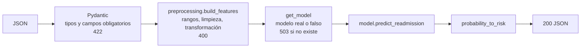

# CI/CD Nivel 3: pruebas unitarias y GitHub Actions

**Curso:** Operaciones de Machine Learning, Pontificia Universidad Javeriana
**Material base:** `Niveles/3/CICD` del repositorio del curso (presentación *Pruebas unitarias e Integración Continua*), sección **03 · Actividades propuestas**.

Esta carpeta resuelve las dos actividades y el reto de esa sección:

| Actividad | Qué pide | Dónde se cumple |
|---|---|---|
| **1 · Pruebas unitarias** | Al menos 3 funciones de preprocesamiento expuestas en FastAPI, `tests/` con 6 pruebas o más, al menos un `pytest.raises`, un Dockerfile que ejecute pytest y que las pruebas pasen dentro del contenedor | `app/`, `tests/` (59 pruebas), `Dockerfile` (etapa `test`) |
| **2 · GitHub Actions** | Ajustar `paths`, `APP_PATH` e `IMAGE_NAME`, abrir un PR que ejecute las pruebas y hacer merge a `main` para que se publique la imagen | `../.github/workflows/ci-cd-unit-tests-dockerhub.yml` |
| **Reto** | Hacer fallar una prueba a propósito en un PR y mostrar que el merge queda bloqueado | [Sección 6](#6-reto-un-pr-con-una-prueba-rota-no-se-puede-integrar) |

---

## 1. Qué construimos y por qué este dominio

La plantilla del profesor usa Iris. Aquí usamos el dataset del **Proyecto 2**, *Diabetes 130-US hospitals*, para que el trabajo no se quede en un ejercicio aislado. Las funciones de preprocesamiento y sus pruebas sirven luego en el DAG de Airflow (paso raw → clean) y en la API de inferencia del Proyecto 2.

La API recibe un registro de un paciente y devuelve la probabilidad de reingreso y una etiqueta de riesgo:

```text
POST /predict  {"age": "[70-80)", "time_in_hospital": 3, ..., "race": "?"}
  -> 200 {"readmission_probability": 0.9555, "risk": "high"}
```



### Estructura

```text
ci_cd/
├── app/
│   ├── preprocessing.py   # 5 funciones puras: no saben nada de HTTP ni del modelo
│   ├── model.py           # cargar el modelo y predecir
│   └── main.py            # FastAPI: solo traduce HTTP <-> funciones
├── tests/
│   ├── conftest.py        # fixtures: registro válido, modelo falso, clientes HTTP
│   ├── test_preprocessing.py
│   ├── test_model.py
│   └── test_api.py
├── workflow_template/
│   └── ci-cd-unit-tests-dockerhub.yml   # copiar a .github/workflows/ (sección 4.4)
├── train_demo_model.py    # modelo DEMO con datos sintéticos (solo para probar la imagen)
├── pytest.ini
├── requirements.txt       # runtime: lo que va en la imagen publicada
├── requirements-dev.txt   # runtime + pytest, pytest-cov, httpx2
├── Dockerfile             # multi-stage: base -> test | runtime
└── .dockerignore / .gitignore
```

---

## 2. Decisiones de diseño (el porqué)

### 2.1 La lógica vive en funciones, no dentro del endpoint

`preprocessing.py` tiene cinco funciones. Las tres primeras son las que pide el enunciado:

| Función | Tipo que pide el enunciado | Qué hace |
|---|---|---|
| `clean_category` | Limpieza de texto | Quita espacios y unifica `"?"`, `"Unknown/Invalid"`, `""` y `None` en `"Unknown"`, que son las formas en que el CSV marca los faltantes |
| `validate_ranges` | Validación de rangos numéricos | Verifica que las 8 variables numéricas existan, sean enteras y estén en su rango. Lanza `KeyError` si falta una columna y `ValueError` si el valor está fuera de rango o tiene el tipo equivocado |
| `age_bracket_to_years` | Transformación de features | Convierte `"[70-80)"` en `75`. El modelo necesita un número y el punto medio conserva el orden entre rangos |
| `build_features` | Composición | Une las tres anteriores y devuelve el vector en el orden fijo `FEATURE_ORDER` |
| `probability_to_risk` | Regla de negocio | Convierte 0.75 en `"high"`. Es el equivalente de `classify_score` del demo del curso |

**Por qué así:** si la lógica estuviera dentro de `@app.post("/predict")`, la única forma de probarla sería enviando peticiones HTTP. Como funciones puras se prueban directamente, en milisegundos y sin FastAPI. Además es **la misma función** en entrenamiento y en serving, que es la defensa contra el *training/serving skew* (la diapositiva *¿Por qué son críticas en ML?*).

### 2.2 Tres códigos de error, tres responsables

| Código | Quién lo produce | Cuándo | Por qué separarlo |
|---|---|---|---|
| **422** | Pydantic (`PatientRecord`) | Falta un campo obligatorio o el tipo no corresponde (`"muchas"` en un número) | Es un error de **contrato**: el cliente no respetó el esquema. FastAPI lo genera solo |
| **400** | `build_features` (nuestro código) | El tipo es correcto pero el valor no tiene sentido (`time_in_hospital = 40`) | Es una regla de **negocio** que vive en un solo lugar y se reutiliza fuera de la API (en Airflow) |
| **503** | `get_model` | El archivo del modelo no existe | El servicio está vivo pero todavía no puede atender. Kubernetes lo interpreta distinto a un 500 |

**Pregunta para pensar:** ¿por qué no poner `Field(ge=1, le=14)` en Pydantic? Funcionaría, pero la regla quedaría duplicada: una copia en la API y otra en el DAG de limpieza. Cuando alguien cambie una sin la otra, entrenamiento y serving dejan de coincidir sin que nada falle.

### 2.3 El modelo es una dependencia que se puede reemplazar

```python
@app.post("/predict")
def predict(record: PatientRecord, model=Depends(get_model)): ...
```

En las pruebas, `app.dependency_overrides[get_model] = lambda: fake_model`. Por qué no usar el modelo real:

- en el Proyecto 2 el modelo vive en MLflow/MinIO; el runner de GitHub no tiene acceso a ellos (ni debe tenerlo);
- sus predicciones cambian cada vez que se reentrena, y una prueba que depende de eso falla sin que el código haya cambiado;
- aquí se prueba **la lógica de la API**. La calidad del modelo es otra prueba, la `slow`.

El `FakeModel` de `conftest.py` además **guarda lo que recibió** (`last_input`). Así `test_predict_readmission_sends_columns_in_model_order` verifica que el modelo recibe las columnas en el orden correcto. Ese es el error silencioso más típico en ML: el modelo no falla, solo predice basura.

`get_model` usa `lru_cache` para leer el archivo del disco **una sola vez** y no en cada petición. Por eso el fixture `client_without_model` llama a `cache_clear()`: si no lo hiciera, una prueba podría recibir el modelo que dejó en caché otra prueba. Las pruebas deben ser **aisladas** (diapositiva *Características de una buena prueba*).

### 2.4 Qué cubren las 59 pruebas

| Archivo | Pruebas | Técnicas del curso que usa |
|---|---|---|
| `test_preprocessing.py` | 44 | `parametrize` con **bordes exactos** (1 y 14 se aceptan, 0 y 15 no; 0.6 es `high`, 0.59 es `medium`), `pytest.raises(..., match=...)` para cada tipo de error, patrón AAA |
| `test_model.py` | 5 | Modelo falso, `tmp_path` (carpeta temporal de pytest), una prueba `@pytest.mark.slow` que entrena y exige accuracy ≥ 0.90 |
| `test_api.py` | 10 | `TestClient`, `dependency_overrides`, `monkeypatch`, verificación de 200/400/422/503 |

Cobertura: **100 %** de `app/`. Como dice la diapositiva, 100 % no garantiza que las pruebas sean buenas. Por eso verificamos que **sí fallan** cuando el código está mal: al cambiar `>= 0.6` por `> 0.6`, falla `test_probability_to_risk[0.6-high]`. Ese es el bug que usaremos en el reto.

### 2.5 Pruebas rápidas y lentas

`test_demo_model_learns_the_synthetic_rule` entrena un modelo de sklearn y por eso está marcada con `@pytest.mark.slow`. `pytest.ini` declara el marcador y `--strict-markers` hace que un marcador mal escrito (`@pytest.mark.slwo`) sea un error y no un filtro que no hace nada.

En CI corren en dos steps separados: primero `-m "not slow"` (falla en segundos si algo básico está roto) y después `-m slow`. Los dos deben pasar para publicar. Hoy la prueba lenta tarda menos de un segundo, pero la separación deja preparado el caso en que entrene con el dataset real.

### 2.6 Un Dockerfile, dos imágenes (multi-stage)

```text
base     python:3.12-slim + requirements.txt        (capa compartida y cacheada)
 ├── test     + requirements-dev.txt + todo el código ; CMD pytest -q
 └── runtime  + solo app/ ; usuario sin privilegios ; CMD uvicorn
```

- La actividad 1 pide *"Dockerfile que ejecute pytest"*: eso es `--target test`.
- La actividad 2 publica una imagen. El Dockerfile del demo del profesor tiene `CMD pytest` y publica **la imagen de pruebas**. Aquí se publica la etapa `runtime`, que es **la API**, sin pytest, sin `tests/` y sin el código de entrenamiento: es la imagen que el Proyecto 2 y Argo CD (Nivel 4) van a desplegar.
- Primero se copia `requirements.txt` y después el código. Si solo cambia el código, Docker reutiliza la capa del `pip install` y el build tarda segundos en vez de minutos.
- `USER appuser`: si alguien explota la API, no queda con permisos de root dentro del contenedor (buena práctica, no esencial).
- El modelo **no** va dentro de la imagen. Llega por `MODEL_PATH` (volumen o initContainer). Así reentrenar no obliga a reconstruir la imagen, y la imagen pesa lo mismo con un modelo de 1 MB que con uno de 500 MB.

### 2.7 Versiones fijadas

`requirements.txt` fija scikit-learn 1.8.0, pandas 2.3.3, numpy 2.4.2 y joblib 1.5.3, las mismas del Proyecto 2 (constraints de Airflow 3.1.8). Es la lección del Proyecto 1: un `.joblib` serializado con una versión de sklearn puede no cargar con otra.

`httpx2` en lugar de `httpx`: con FastAPI 0.162 / Starlette 1.10, `TestClient` muestra `StarletteDeprecationWarning: Using httpx ... is deprecated; install httpx2`. La diapositiva dice `httpx` porque es anterior a ese cambio. Verificamos que con solo `httpx2` instalado las 59 pruebas pasan sin avisos.

---

## 3. Actividad 1: ejecutar las pruebas

### 3.1 Local (Mac)

Desde `ci_cd/`:

```bash
python3.12 -m venv .venv          # o: uv venv -p 3.12 .venv
source .venv/bin/activate
pip install -r requirements-dev.txt

pytest -q                         # las 59
pytest -m "not slow" --cov=app --cov-report=term-missing
pytest -k predict                 # solo las que tienen "predict" en el nombre
pytest -x --lf                    # repetir solo las que fallaron, parar en la primera
```

Salida esperada:

```text
59 passed in ~1s
...
app/main.py            40      0   100%
app/model.py           15      0   100%
app/preprocessing.py   57      0   100%
TOTAL                 112      0   100%
```

### 3.2 En contenedor (requisito de la actividad 1)

```bash
docker build --target test -t readmission-api:test .
docker run --rm readmission-api:test
echo $?        # 0 = todas pasaron. Ese número es lo que lee GitHub Actions
```

**Evidencia:** captura de la salida `59 passed` del `docker run`, y de `echo $?` en 0.

### 3.3 (Opcional) La imagen runtime de punta a punta

```bash
python train_demo_model.py models/model.joblib     # modelo DEMO, datos sintéticos
docker build --target runtime -t readmission-api:dev .
docker run --rm -p 8000:8000 -v "$PWD/models:/models" readmission-api:dev
```

En otra terminal:

```bash
curl localhost:8000/health
curl -X POST localhost:8000/predict -H 'content-type: application/json' -d '{
  "age":"[70-80)","time_in_hospital":3,"num_lab_procedures":41,"num_procedures":0,
  "num_medications":15,"number_outpatient":0,"number_emergency":0,
  "number_inpatient":5,"number_diagnoses":9,"race":"?"}'
# -> {"readmission_probability":0.9555,"risk":"high"}
```

Si se omite `-v`, `/health` responde 200 y `/predict` responde 503: el comportamiento diseñado en la sección 2.2. También se puede abrir `http://localhost:8000/docs`.

---

## 4. Actividad 2: el workflow

Archivo: `.github/workflows/ci-cd-unit-tests-dockerhub.yml`, en la **raíz** del repo. GitHub solo lee workflows de esa carpeta. Por eso no vive dentro de `ci_cd/`.

### 4.1 Qué se cambió frente a la plantilla y por qué

| Cambio | Plantilla | Aquí | Por qué |
|---|---|---|---|
| `paths` | `Niveles/3/CICD/unit_testing/demo_app/**` | `ci_cd/**` + el propio workflow | El repo es un monorepo (taller001…004, proyecto1, proyecto2). Un cambio en `proyecto2/` no debe correr estas pruebas. El workflow se incluye para que corra cuando se edita a sí mismo |
| `APP_PATH` | ruta del demo | `ci_cd` | Pedido por la actividad |
| `IMAGE_NAME` | `<dockerhub-usuario>/...` | `dierick/mlops-readmission-api` | Pedido por la actividad |
| Python | 3.11 | 3.12 | Igual al Proyecto 2 |
| Dependencias | `requirements.txt` | `requirements-dev.txt` + caché de pip | Las herramientas de prueba no van en runtime. La caché ahorra unos 30 s por ejecución |
| Pruebas | `pytest -q` | `-m "not slow" --cov` y luego `-m slow` | Retroalimentación rápida y uso de los marcadores (sección 2.5) |
| **Job `docker-tests`** | no existe | build `--target test` + `docker run` | Sin este job, un Dockerfile roto pasaría el PR en verde y solo se descubriría **después** del merge, cuando falle `publish-dockerhub` en `main`. Así el PR también valida que la imagen construye |
| `needs` | `unit-tests` | `[unit-tests, docker-tests]` | Solo se publica si **las dos** validaciones pasaron |
| `target` / `platforms` | no hay | `runtime` / `linux/amd64` | Publicar la API (no la imagen de pruebas) para la arquitectura de la VM |
| `workflow_dispatch` | no hay | agregado | Permite relanzar el workflow a mano desde la pestaña Actions para depurar |

El workflow pasó `actionlint` (validador de sintaxis y expresiones de GitHub Actions).

### 4.2 Qué corre en cada situación

| Situación | `unit-tests` | `docker-tests` | `publish-dockerhub` |
|---|---|---|---|
| Push a `feature/**` que toca `ci_cd/` | corre | corre | omitido (`if`) |
| PR hacia `main` | corre | corre | omitido (`if`: el evento es `pull_request`) |
| Merge a `main` con todo en verde | corre | corre | **publica `:latest` y `:<sha>`** |
| Push a `main` con una prueba rota | falla | corre | no corre (`needs`) |
| Cambio solo en `proyecto2/` | el workflow no se dispara (`paths`) | | |

**Dos tags:** `:latest` es cómodo pero se mueve. `:<sha>` es inmutable: dice exactamente qué commit generó la imagen. En el Nivel 4, Argo CD despliega por `:<sha>` para que "qué corre en el clúster" tenga una sola respuesta.

### 4.3 Configuración en Docker Hub y GitHub (una sola vez)

1. **Token de Docker Hub:** *Account Settings → Personal access tokens → Generate new token*, con permisos **Read & Write**. Se usa el token y nunca la contraseña: se puede revocar sin cambiar la contraseña y solo da acceso al registro.
2. **Environment `dockerhub` con los secrets** (no como secrets del repo). En `Dierickb/mlops-assignment`: *Settings → Environments → New environment* → nombre `dockerhub`:
   - *Deployment branches and tags* → **Selected branches and tags** → agregar `main`
   - *Environment secrets* → `DOCKERHUB_USERNAME` = `dierick` y `DOCKERHUB_TOKEN` = el token del paso 1
   - (Opcional) *Required reviewers*: un integrante del grupo debe aprobar cada publicación. Marcar *Prevent self-review* para que quien hizo el merge no se apruebe a sí mismo.

   **Por qué un environment y no secrets del repo:** los secrets del repo llegan a **cualquier rama** del mismo repo. Un integrante con permiso de escritura podría hacer push a `feature/x` con el workflow modificado (sin el `if`, o con un `curl` del token) y publicar o robar el token sin pasar por un PR. El `if` del job vive en el YAML, que cualquiera con escritura puede editar: es una conveniencia, no un control. La regla "solo `main`" del environment vive en *Settings*, que solo un admin cambia, y `main` está protegida (sección 5), así que a `main` solo se llega con un PR en verde. Con PRs desde forks no hay que hacer nada: GitHub no les pasa secrets de ningún tipo.

   El environment hay que crearlo **antes** del primer merge. Si el workflow menciona un environment que no existe, GitHub lo crea vacío y sin reglas, y el login falla por falta de secrets.
3. El repositorio `dierick/mlops-readmission-api` en Docker Hub **no hay que crearlo**: el primer push lo crea con la privacidad por defecto de la cuenta.

### 4.4 Flujo de git paso a paso

El repo local está en la rama `taller004`, con `.DS_Store` modificado y `proyecto2/` sin versionar. Para no mezclar nada en el commit:

```bash
cd ~/Documents/MLOPs/projects/mlops-assignment

# 0. Dejar limpio .DS_Store (archivo de macOS, no aporta nada al repo)
git restore .DS_Store

# 1. Partir de main actualizado. Los archivos sin versionar (ci_cd/, el workflow,
#    proyecto2/) viajan con nosotros al cambiar de rama; no se pierden.
git switch main
git pull origin main

# 2. Rama de trabajo. El nombre feature/** dispara el workflow en cada push.
git switch -c feature/ci-cd-pruebas

# 3. Activar el workflow: GitHub solo lee .github/workflows/ en la raíz
#    (mismo paso que la diapositiva "Secrets, tags y activación")
mkdir -p .github/workflows
cp ci_cd/workflow_template/ci-cd-unit-tests-dockerhub.yml .github/workflows/

# 4. Agregar SOLO lo de esta actividad (proyecto2/ queda fuera)
git add ci_cd .github/workflows/ci-cd-unit-tests-dockerhub.yml
git status                       # verificar que solo aparecen esos archivos
git commit -m "ci_cd: API de reingreso con pruebas pytest y workflow de CI"
git push -u origin feature/ci-cd-pruebas
```

5. En GitHub → **Actions**: deben correr `unit-tests` y `docker-tests` en verde, y `publish-dockerhub` debe aparecer como *skipped*. **Evidencia 1.**
6. **Pull request** `feature/ci-cd-pruebas → main`. Corren otra vez y aparecen como *checks* en el PR.
7. **Proteger `main`** (sección 5). Se hace aquí y no antes porque GitHub solo deja elegir como *required* los checks que ya corrieron al menos una vez.
8. **Merge**. En Actions, el run de `main` ejecuta los tres jobs y `publish-dockerhub` queda en verde. **Evidencia 2.**
9. En `hub.docker.com/r/dierick/mlops-readmission-api/tags` deben aparecer `latest` y el SHA del commit de merge. **Evidencia 3** (enlace).

---

## 5. Proteger la rama `main`

*Settings → Rules → Rulesets → New branch ruleset* (o *Settings → Branches → Add classic branch protection rule*):

- **Target:** rama por defecto (`main`)
- ☑ *Require a pull request before merging*
- ☑ *Require status checks to pass* → agregar `unit-tests` y `docker-tests`
- **Bypass list vacía** (ruleset) o ☑ *Do not allow bypassing the above settings* (regla clásica)

Sin el último punto, como somos administradores del repo, GitHub muestra *"Merge without waiting for requirements to be met (bypass rules)"* y el reto no demuestra nada.

> El repositorio `Dierickb/mlops-assignment` es **público**, así que las reglas de protección aplican también en GitHub Free.

---

## 6. Reto: un PR con una prueba rota no se puede integrar

El bug elegido es realista: un `>=` que se convierte en `>`. Nadie lo nota leyendo el código y cambia la etiqueta de los pacientes con probabilidad exactamente 0.6.

```bash
git switch main && git pull
git switch -c feature/reto-prueba-falla
# en ci_cd/app/preprocessing.py, dentro de probability_to_risk:
#   if probability >= 0.6:   ->   if probability > 0.6:
git commit -am "reto: umbral de riesgo alto con > en vez de >="
git push -u origin feature/reto-prueba-falla
```

Abrir el PR hacia `main`. Resultado esperado:

```text
FAILED tests/test_preprocessing.py::test_probability_to_risk[0.6-high]
  AssertionError: assert 'medium' == 'high'
1 failed, 58 passed
```

- `unit-tests` ✗ y `docker-tests` ✗ (las pruebas también corren dentro del contenedor)
- En el PR: *"Merging is blocked — Required status checks have failed"*. **Evidencia del reto:** captura de ese mensaje y del log del step fallido.

Después: cerrar el PR sin merge y borrar la rama. Si hay tiempo, vale la pena mostrar también el camino de corrección: revertir el cambio en la misma rama, hacer push, ver que el PR se pone en verde y que el botón de merge se habilita.

---

## 7. Checklist de evidencias

- [ ] `docker run --rm readmission-api:test` → `59 passed` y código de salida 0 (actividad 1)
- [ ] Run del push a `feature/ci-cd-pruebas`: `unit-tests` y `docker-tests` en verde, `publish-dockerhub` *skipped*
- [ ] PR con los checks en verde
- [ ] Run en `main` con `publish-dockerhub` en verde
- [ ] Enlace a `hub.docker.com/r/dierick/mlops-readmission-api` con los tags `latest` y `<sha>`
- [ ] Reto: PR bloqueado con `test_probability_to_risk[0.6-high]` fallando

---

## 8. Problemas comunes

| Síntoma | Causa probable | Solución |
|---|---|---|
| El workflow no aparece en Actions | El archivo no está en `.github/workflows/` de la raíz, o el push no tocó nada dentro de `paths` | Verificar la ruta. Usar *Run workflow* (`workflow_dispatch`) |
| `ModuleNotFoundError: app` en pytest | pytest se ejecutó fuera de `ci_cd/` | Ejecutar desde `ci_cd/`. `pytest.ini` define `pythonpath = .` relativo a esa carpeta |
| `denied: requested access to the resource is denied` en el push | Secret mal escrito, token de solo lectura, o `IMAGE_NAME` con otro usuario | Revisar los nombres exactos de los secrets y que el token sea *Read & Write* |
| `Error: Username and password required` | Los secrets no existen o el run viene de un fork | Crear los secrets en el repo (no en el environment) |
| En el PR no se pueden elegir los checks como *required* | Los checks nunca han corrido | Hacer primero un push que dispare el workflow |
| `main` aparece con ✗ después del merge, en "Deploy to VM" | Ver la sección 9 | |

---

## 9. Ojo: `deploy.yml` también se dispara con el merge

El repo ya tiene `.github/workflows/deploy.yml` (taller001). Se dispara con **cualquier** push a `main`, sin filtro `paths`, y se conecta por SSH desde un runner de GitHub a una VM que solo es accesible por VPN. Al hacer merge de esta actividad también va a correr y muy probablemente fallará. No bloquea la publicación (son workflows independientes), pero deja una ✗ roja en `main` que confunde las evidencias.

Opciones, a decidir:

1. Agregarle `paths: ["taller001/**"]`, el mismo principio de monorepo de la sección 4.1. Es la recomendada.
2. Desactivarlo en *Actions → Deploy to VM → ··· → Disable workflow*.
3. Dejarlo y explicarlo en la entrega.

---

## 10. Preguntas para pensar (y para la sustentación)

1. Si mañana el Proyecto 2 cambia el umbral de riesgo alto a 0.7, ¿cuántas pruebas deberían fallar? ¿Es eso bueno o malo?
2. `docker-tests` repite las mismas pruebas que `unit-tests`. ¿Qué detecta uno que el otro no? (Pista: dependencias del sistema, un `COPY` olvidado, `.dockerignore`.)
3. Con `publish-dockerhub`, ¿qué pasa si dos merges a `main` ocurren con un minuto de diferencia? ¿Qué tag queda como `latest`? ¿Y por qué eso no le importa a Argo CD?
4. ¿Qué prueba agregarían para detectar *training/serving skew* si el DAG de Airflow y la API importaran `build_features` desde lugares distintos?
5. Hoy la prueba `slow` usa datos sintéticos. ¿Qué cambiaría para que sea una verdadera prueba de **regresión** contra el modelo `champion` de MLflow, y por qué no debería correr en cada push?
